<!-- SPDX-License-Identifier: GPL-3.0-or-later -->
# Slingshot reverse engineering with REA

**2026-11-06. Static research, not hardware approval or a recovered open-source
release of Slingshot.** This investigation started from freshly fetched `main`
`d42c5c21e15674d6f14827030059f95e61c4e4ca`. Existing local compatibility-review
work was preserved separately. The protected `goliath-link/` tree remains
`c29e44575b24b8294ffc9917b1c3ab8313cdb6d6`.

The requested [REA repository](https://github.com/morluto/rea) was cloned and
built locally at **`39bd0cc625be27da810d4ec4444770236aa30647`**, package version
**6.8.0**. Its static .NET tools were run on the owner's five Slingshot
installers after extraction. ILSpy supplied readable reconstruction for tracing
control flow. Neither Slingshot, its installers, nor its firmware updater was
executed; no robot connection, application command, upload or flash was made.

## Results that change the replacement plan

1. **The vendor parses this robot's firmware banner incorrectly.** Removing all
   non-digits/non-dots from the whole suffix turns the observed version plus
   build date into `1.0.1322021`. That crosses its `1.0.14` cage/SSID threshold
   despite the actual firmware being `01.00.13`. All five inspected hosts have
   this filtering pattern. The existing replacement parser isolates the first
   three-part version and does not reproduce this date-folding problem.
2. **The vendor's cage path is not a safety specification.** Unknown or stale
   cage state can advance the upload workflow, and polling helpers ignore send
   failures. A replacement must require a fresh explicit CLOSED observation
   before any operation relying on the cage; timer expiration is insufficient.
3. **Projects can be preserved independently of the proprietary CAM engine.**
   Project manifests are XML; work areas are SVG plus `QI_*` machining fields.
   `.qcm` is an XML machining intermediate, while `.ute` uses BinaryFormatter.
   They need different readers. An offline project importer is a useful next
   preservation feature; it need not recreate Slingshot's geometry engine.
4. **Rebuilding the decompiled application would not produce a Linux port.**
   Its main assembly targets .NET Framework 4.8 and references WPF and
   Windows-oriented Wi-Fi components. The original cross-platform replacement
   remains the appropriate implementation path. The native updater, obfuscated
   libraries, and separately attributed geometry/CAM components are additional
   boundaries, not dependencies to silently carry into a public replacement.
5. **Do not update this robot's firmware on the strength of the host updater.**
   Its Wi-Fi loader does not establish compatibility or recovery, and its
   displayed version is not bound to the file's bytes. The three bundled HEX
   files are identical; this pass recovered no `01.00.13` image or rollback
   procedure. This conclusion preserves the current hardware hold.

Detailed evidence and exact local reconstruction coordinates are in
[host compatibility](slingshot-host-compatibility.md) and
[project formats and CAM](slingshot-project-format.md). Those documents describe
host behavior and inferred consequences; neither substitutes for robot-handler
evidence on `01.00.13`.

## Evidence and coverage

The [artifact manifest](slingshot-artifact-manifest.json) records SHA-256 and
size for five original installers and **588 files under their `app/` payloads**.
It includes REA identity/metadata results for **41 selected artifacts**:
36 managed assemblies and five copies of the non-managed firmware updater.
All 36 managed assemblies were also reconstructed locally with ILSpy.
Extraction additionally produced installer support files outside `app/`; these
are not included in the 588-entry payload inventory.

| Installer label | Main assembly version | `app/` files | Selected artifacts |
|---|---|---:|---:|
| 1.7.12.0.0 | 1.7.12.0 | 105 | 7 |
| 1.8.0.0 | 1.8.0.0 | 104 | 7 |
| 1.09.05 | 1.9.5.1 | 133 | 9 |
| 1.9.1.0 | 1.9.1.0 | 123 | 9 |
| 1.9.3.0 | 1.9.3.0 | 123 | 9 |

Installer labels, assembly versions and robot firmware versions are distinct
identities. Do not infer release chronology or robot compatibility by sorting
the assembly-version column.

REA reports complete artifact metadata coverage for 31 inputs. For all five
`SysLavISOBase.dll` inputs it reports **partial** coverage: duplicate Module and
Assembly metadata rows violate its expected table cardinalities. The five
`GoliathFirmwareTool.exe` inputs have no CLI directory, so managed metadata/CIL
is **unavailable**, not an empty managed program. This separate executable was
not successfully unpacked or natively decompiled in this pass.

The [selected evidence index](slingshot-evidence-index.json) retains Evidence
IDs, artifact hashes, coverage, method tokens and comparison limits. Full REA
JSON, CIL, reconstructed C#, XAML and extracted resources remain in locally
ignored storage. The index is intentionally not a replacement for the full
evidence needed to reproduce a specific interpretation.

Additional checks:

- Selected REA member inspection of `GoliathStatus`, `SendingGCode` and
  `SetupStep080` in Slingshot 1.9.3.0: 141 methods, complete coverage, no
  unmatched requested type. Method coordinates corroborate the host trace.
- TCP library 1.9.1.0 → 1.9.3.0: 241 unchanged, 23 changed, four added and nine
  unknown **member classifications**. These counts include fields and methods;
  they are not counts of protocol changes.
- Postprocessor 1.7.12.0.0 → 1.9.3.0: 151 unchanged classifications and four
  unknown; none classified changed, added or removed. The four unknown methods
  include the file generator. REA does not compare literal text or field
  constant defaults in this comparison, and local-signature uncertainty remains.
  Thus this is corroboration of continuity, **not proof of byte-for-byte output
  equivalence** or a fresh validation of every existing dialect claim.
- All three `app/Firmware/Latest.hex` files have 432,556 bytes and SHA-256
  `becb05b786cd9618f3843a0df976e6d48b04afb682a0598571d284651103f54b`.
  Existing [firmware analysis](../protocol/09-firmware-01.02.00.md) identifies
  that surviving image as `01.02.00`; this pass checked equality, not its handlers.
- REA found zero declared P/Invoke imports in `Slingshot.exe` itself. That does
  not negate Windows dependencies in its referenced frameworks/libraries.

## Architecture recovered

```mermaid
flowchart LR
    Project[XML project manifest] --> WorkArea[SVG work areas and machining fields]
    WorkArea --> Editor[Editor and cut geometry]
    Editor --> Planner[WorkLogic operation planning]
    Planner --> Post[PPGoliath postprocessor]
    Post --> NC[NC job text]
    NC --> Cleaner[Upload text cleaner]
    Cleaner --> Session[Host job and status controllers]
    Session --> Comms[Three TCP connections]
    Comms --> Robot[Robot firmware]
```



`WorkLogicLibrary`, `SysLavGest`, `SysLavISOBase` and geometry dependencies do
substantial work before postprocessing: compensation, pass expansion, bridges,
pocketing, ordering and inserted maintenance moves. Producing the Goliath wire
dialect is only one part of replacing the editor. The
[project-format report](slingshot-project-format.md) supplies source anchors and
marks the unverified schema/geometry details.

The recovered TCP reader also must not be copied as a framing specification.
In 1.9.3.0 `GoliathCommLibTCP/GoliathCommLib/SocketManager.cs`, `Read` at line 578
clears accumulated text after processing available data and constructs binary
candidates from the last read buffer. Partial text, split binary messages and
coalesced frames therefore need independent stream-level handling. This is
static control-flow evidence, not a runtime reproduction. The replacement's
own framing design and fragmentation tests remain the implementation baseline.

## What already exists, and what remains

Latest `main` already implements the B4 early stop in the probe, including a
send-lock check and contradictory/partial-identity handling. Its importer rejects
stopped probes and shareable copies. The earlier review's request to add that
probe stop is **superseded**, not an outstanding change.

The replacement already has protocol/transport code, a simulator, preparation
parsing/geometry/heading foundations, facts and capability gates, recording,
diagnostic export, local UI infrastructure and CAM posts. It is not yet an
end-to-end released replacement: source inventory found no complete preparation
planner/checker/emitter/bundle pipeline or robot session controller/application
CLI. The UI accepts injected snapshots/intents; it is not itself a robot driver.

| Priority | Remaining work | Required evidence before advancing |
|---|---|---|
| Before next observation | Separate receive-only TCP observer outside the frozen driver | No application-send API; zero-send checks on success, timeout, partial connection and interruption; bounded collection and complete teardown; distinct report format rejected by the R1 importer |
| Before command-capable library use | Session-wide old/unknown-firmware admission | `FirmwareCapabilities.supports_command` currently permits many unlisted commands; probe protection does not protect arbitrary direct client calls. Preserve the runner's B4 gate independently |
| Before cage-dependent operation | Strict firmware identity and fresh cage state | Reject ambiguous identities and UNKNOWN/stale cage state; establish actual legacy handler effects before sending polling or one-shot queries |
| Before accepting diagnostic status | Version-specific sanity/status interpretation | The observed `01.00.13` report is S1 multiline text, not the `INFO;40` S2 array. Require a complete transaction with named results; do not invent global status/tower capability from silence |
| Offline preservation | Project manifest/SVG importer | Explicit units, transform and operation handling, unsupported-field diagnostics, real owner-project fixtures; no vendor deserialization or automatic machining |
| Before jobs | Complete prep/runner integration and validate upload/stop semantics | Host writes plus a timer are unconfirmed; neither Slingshot's UI nor static host analysis proves safe abort, disconnect or motion behavior on this robot |
| Separate recovery research | Native updater and firmware/bootloader recovery | Preserve/recover the existing image and establish hardware/tower compatibility and rollback before considering a flash |

The next hardware action remains a **receive-only observation after that tool
has been implemented and reviewed**. This research does not supply a ready
observer command, authorize extended probing, or lift B4. The current probe
should still stop on `01.00.13`.

## Reproducing this investigation

Use owner-supplied installer files outside tracked source. The project does not
download or redistribute them. Keep tools and all raw outputs in an ignored
`.local-research/` directory or a separate private directory. The working layout
used here is `rea/`, `tools/`, `extracted/<label>/app/`,
`decompiled/<label>/<assembly>/`, and `evidence/` beneath that research directory.
The source coordinates in the companion reports refer to this reproducible
layout, not publicly available vendor source links.

Tool versions used:

| Tool | Version / setup |
|---|---|
| REA | Commit above; locked `npm ci`, then `npm run build:cached` |
| Node | Portable 24.22.1; ZIP checked against the publisher's SHA-256 list |
| innoextract | 1.9, [publisher distribution](https://constexpr.org/innoextract/); static installer extraction |
| ILSpy command line | 9.1.0.7988, [NuGet package](https://www.nuget.org/packages/ilspycmd/9.1.0.7988); existing .NET 8.0.33 runtime |
| Inventory script | Python 3.13.13 used; standard-library implementation compatible with Python 3.9+ |

On Windows, REA's Git checkout does not contain its native control module.
Restore the **matching 6.8.0** npm package's `native/windows/build/manifest.json`
and `rea-windows-x64.node`, then run its verification script as described in
[REA's pinned Windows instructions](https://github.com/morluto/rea/blob/39bd0cc625be27da810d4ec4444770236aa30647/native/windows/README.md).
The restored module's verified SHA-256 was
`6a015bfefee7fafb6cbafab659f040170848a45425bbcef6caf962fd39b6ff7b`.
The build passed. No global MCP configuration or installed system runtime was
changed; this investigation used REA's CLI.

Extract each installer with `innoextract --extract --output-dir <label-dir>
<installer>`, creating the parent directory first. Reconstruct managed inputs
with `dotnet <ilspycmd.dll> --disable-updatecheck -p -o <new-output-directory>
<assembly>`. Never run the installer to extract it. The native firmware updater
is not an ILSpy target.

The checked-in [inventory tool](../../tools/slingshot_inventory.py) reads
already extracted directories, invokes only REA's static artifact inspector,
checks each returned artifact digest, and writes an explicit metadata allowlist:

```text
python tools/slingshot_inventory.py --extracted-root <research>/extracted --installer-root <private-installer-archive> --rea-root <research>/rea --node <node-executable> --evidence-dir <new-private-evidence-directory> --manifest <new-manifest.json>
```

It refuses existing output paths, preserves failures instead of claiming empty
coverage, and never opens a network connection to the robot. For focused CIL,
run REA `inspect-managed-members <Slingshot.exe> --type
GoliathWPF.Helpers.GoliathStatus --type GoliathWPF.SendingGCode --type
GoliathWPF.SetupStep080 --json` and redirect the complete JSON locally. For the
two comparisons, use `compare-managed-members <left-assembly> <right-assembly>
--json`. Exact identities and tool limitations are recorded in the manifest
and evidence index. Treat a new REA version as a new analysis environment.

## Publication boundary and unfinished coverage

Offline validation completed: the inventory tool ran end to end across all
five versions; a separate pass recomputed all 588 payload hashes and four
selected evidence-file hashes, checked the selected method bodies for complete
instruction decoding, reproduced the banner-parsing difference without loading
vendor code, and checked the new document links. Repository checks ran with
`python -m pytest tests/test_slingshot_inventory.py tests/test_repo_docs.py
tests/test_field_guides.py tests/arch/test_goliath_link_freeze.py -q
-p no:cacheprovider`: **93 passed, one skipped**. Four authored-fixture cases
verify that invalid/empty inventory inputs fail before creating evidence or
running REA. These checks validate the research artifacts and repository
boundaries; they do not validate hardware behavior.

This change publishes original analysis, file identities and a research tool.
It does not publish vendor installers, recovered source, assets, or firmware,
and does not alter [project licensing](../../LICENSING.md). Separately attributed
dependencies remain separate; a company's status is not evidence that this
repository owns its components. Any implementation should be written from the
documented interface/data facts, preserving the project's existing separation.

Native updater behavior, old robot firmware handlers, complete project-schema
coverage, geometry equivalence, UI runtime behavior, bootloader recovery and
real hardware timing remain unresolved. This is a reproducible static
investigation with useful new findings, not a claim to have completely recovered
or validated Slingshot.
